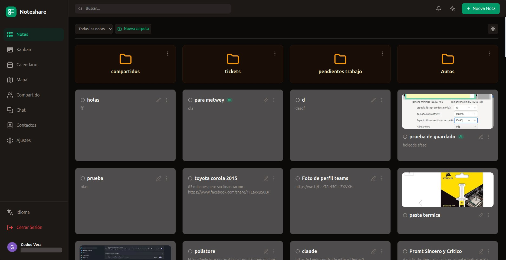
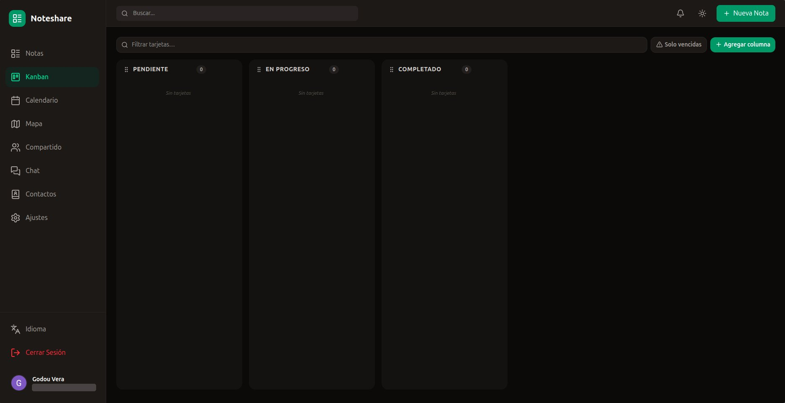
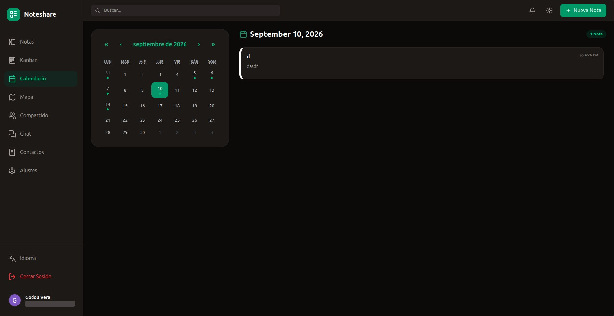
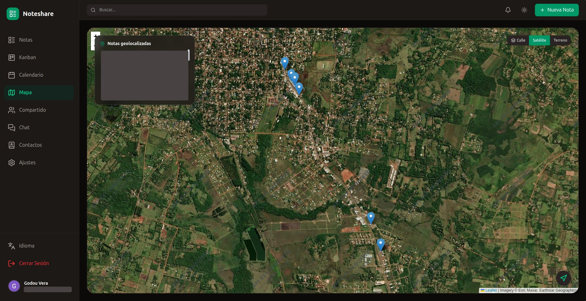
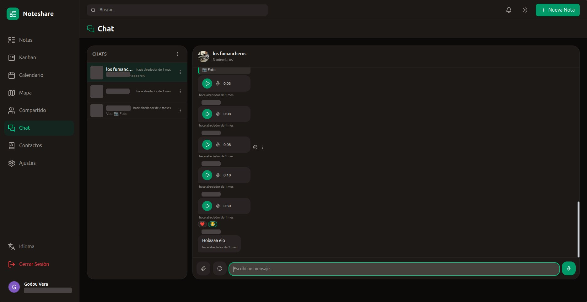
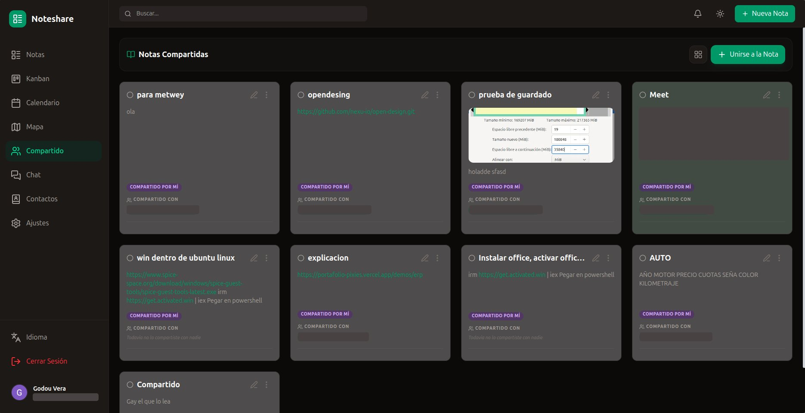
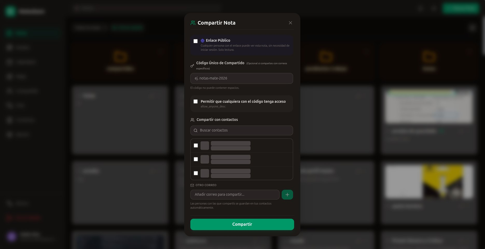
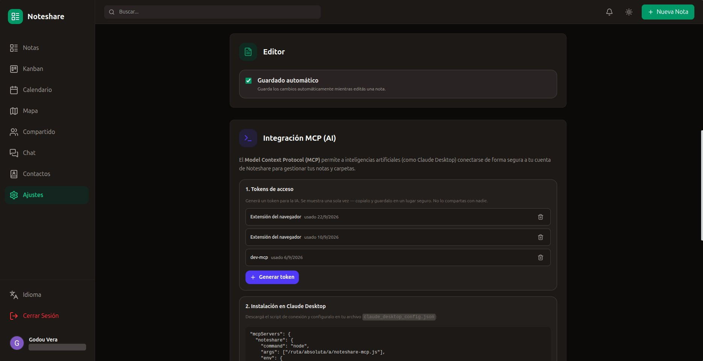
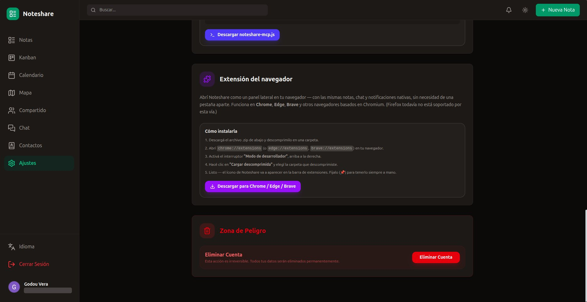

<div align="center">

# 📝 Noteshare

**Open-source collaborative notes: notes, Kanban, calendar, map, sharing, real-time chat, AI (MCP) integration and a browser extension.**

[](LICENSE)




</div>

---

## Features

- **Notes & lists** with text, images (upload / camera), tags, folders, pinning and colours.
- **Kanban board** with custom columns, drag & drop and due-date filtering.
- **Calendar** view of notes by date.
- **Map** of geolocated notes (Leaflet; street, satellite and terrain layers).
- **Sharing**: public read-only links, share codes, share with contacts or by email, comments on shared notes.
- **Contacts** address book (auto-filled from the people you share with).
- **Real-time chat**: direct and group conversations, text, images, voice notes, stickers, replies, edit/delete and emoji reactions (Server-Sent Events).
- **Notifications** (in-app bell + optional email through Brevo).
- **MCP integration**: personal access tokens + a ready-to-use MCP server so AI assistants (e.g. Claude Desktop) can read and manage your notes.
- **Browser extension** (Chrome / Edge / Brave) with a side panel for quick capture.
- **Export** notes to PDF, Excel and Word.
- **i18n** in 8 languages (ES, EN, FR, DE, IT, PT, ZH, JA) and light / dark themes.

## Screenshots

| | |
|---|---|
|  |  |
|  |  |
|  |  |
|  |  |

> Screenshots come from a demo account; personal data was redacted.

## Architecture

npm-workspaces monorepo:

```
apps/
  api/         Express 4 + Prisma 6 + PostgreSQL REST API (TypeScript)
  web/         React 19 + Vite 6 + Tailwind 4 single-page app
  extension/   Chrome/Edge (MV3) + Firefox side-panel extension
packages/
  shared/      Types and helpers shared by api and web
docs/          Screenshots
```

| Layer | Stack |
|-------|-------|
| Frontend | React, TypeScript, Vite, Tailwind CSS, TanStack Query, dnd-kit, Leaflet, i18next |
| Backend | Node.js, Express, Prisma, Zod, JWT (httpOnly cookies), multer + sharp (images) |
| Database | PostgreSQL |
| Auth | Google OAuth 2.0 → JWT cookies; personal access tokens (`ns_pat_…`) for MCP / extension |
| Realtime | Server-Sent Events |
| Email (optional) | Brevo transactional REST API |

## What you need to provide

Noteshare ships with **no credentials or third-party connections**. Before it is usable you must supply:

| # | Requirement | Required? | Where it goes |
|---|-------------|-----------|---------------|
| 1 | **Node.js ≥ 20** (or just Docker) | yes | — |
| 2 | **PostgreSQL 14+** database | yes (bundled in `docker-compose.yml`) | `DATABASE_URL` |
| 3 | **Two random secrets** (`openssl rand -hex 32`) | yes | `JWT_ACCESS_SECRET`, `JWT_REFRESH_SECRET` |
| 4 | **Google OAuth client** (Web application) | yes — it is the only login method | `GOOGLE_OAUTH_CLIENT_ID`, `GOOGLE_OAUTH_CLIENT_SECRET`, `GOOGLE_OAUTH_REDIRECT_URI` |
| 5 | **Public URLs** of the web app and the API | yes | `WEB_ORIGIN`, `API_PUBLIC_URL`, `VITE_API_URL` |
| 6 | **Persistent storage** for `UPLOADS_DIR` (uploaded images / audio) | yes in production | Docker volume or mounted disk |
| 7 | **HTTPS + same registrable domain** for web and API (e.g. `app.example.com` + `api.example.com`) | yes in production | reverse proxy / hosting |
| 8 | **Brevo account** + verified sender | optional | `BREVO_API_KEY`, `BREVO_SENDER_EMAIL`, `BREVO_SENDER_NAME` |
| 9 | **Admin emails** | optional | `ADMIN_EMAILS` |

### Creating the Google OAuth client

1. Go to <https://console.cloud.google.com/apis/credentials> → **Create credentials → OAuth client ID → Web application**.
2. Add the authorized redirect URI: `<API_PUBLIC_URL>/api/auth/google/callback`
   (local: `http://localhost:3001/api/auth/google/callback`).
3. Copy the client ID and secret into your `.env`.
4. Configure the OAuth consent screen (add yourself as a test user while in "Testing" mode).

### Environment variables

See [`.env.example`](.env.example) (Docker, root), [`apps/api/.env.example`](apps/api/.env.example) (API run directly) and [`apps/web/.env.example`](apps/web/.env.example).

| Variable | Description |
|----------|-------------|
| `DATABASE_URL` | PostgreSQL connection string |
| `WEB_ORIGIN` | Public origin of the web app (CORS + post-login redirect) |
| `API_PUBLIC_URL` | Public origin of the API (absolute image URLs) |
| `VITE_API_URL` | API URL baked into the web bundle at build time |
| `GOOGLE_OAUTH_CLIENT_ID` / `_SECRET` / `GOOGLE_OAUTH_REDIRECT_URI` | Google sign-in |
| `JWT_ACCESS_SECRET` / `JWT_REFRESH_SECRET` | Session signing secrets (≥ 8 chars, use 64 hex) |
| `UPLOADS_DIR` | Where uploaded files are stored (default `./uploads`) |
| `ADMIN_EMAILS` | Comma-separated admin emails |
| `BREVO_API_KEY` / `BREVO_SENDER_EMAIL` / `BREVO_SENDER_NAME` | Email; when empty, emails are only logged |
| `PORT` | API port (default 3001) |

## Quick start with Docker (recommended)

```bash
git clone <this-repo> noteshare && cd noteshare
cp .env.example .env
# edit .env: secrets, Google OAuth, public URLs
docker compose up -d --build
```

- Web: <http://localhost:3000> · API: <http://localhost:3001/api/health>
- Migrations run automatically when the API container starts.
- Data lives in the `db-data` and `uploads` Docker volumes.

> `VITE_API_URL` is compiled into the web bundle, so after changing `API_PUBLIC_URL` rebuild with `docker compose up -d --build web`.

## Local development (without Docker)

```bash
npm install
cp apps/api/.env.example apps/api/.env   # fill it in
cp apps/web/.env.example apps/web/.env

# a PostgreSQL instance matching DATABASE_URL, e.g.:
docker run -d --name noteshare-db -p 5432:5432 \
  -e POSTGRES_USER=noteshare -e POSTGRES_PASSWORD=change-me -e POSTGRES_DB=noteshare postgres:16-alpine

npm run migrate:dev -w @noteshare/api     # create the schema
npm run dev:api                           # http://localhost:3001
npm run dev:web                           # http://localhost:3000
```

Useful scripts: `npm run build`, `npm run lint`, `npm run migrate:deploy -w @noteshare/api`,
`npm run backfill:contacts -w @noteshare/api` (one-off: seed contacts from existing shares).

## Deploying to production

Any host that runs containers or Node works (VPS + Docker, Coolify, Railway, Fly.io…).

1. Provision PostgreSQL and a persistent volume for uploads.
2. Deploy the **API** (`apps/api/Dockerfile`, port 3001) with the environment above and `NODE_ENV=production`.
3. Deploy the **web** (`apps/web/Dockerfile`, port 80) with build arg `VITE_API_URL=<API public URL>`.
4. Put both behind HTTPS on subdomains of the same domain (cookies are `SameSite=Lax`, `Secure` in production).
5. Make sure the Google redirect URI matches `<API_PUBLIC_URL>/api/auth/google/callback`.
6. Check `GET <API_PUBLIC_URL>/api/health` returns `{"ok":true}`.

Build context for both Dockerfiles is the **repository root**.

## MCP integration (AI assistants)

1. In the app: **Settings → Integración MCP → Generar token**.
2. Download `noteshare-mcp.js` from the same page (served from `apps/web/public/noteshare-mcp.js`).
3. Add to Claude Desktop's `claude_desktop_config.json`:

```json
{
  "mcpServers": {
    "noteshare": {
      "command": "node",
      "args": ["/absolute/path/to/noteshare-mcp.js"],
      "env": {
        "NOTESHARE_API_URL": "https://api.your-domain.com",
        "NOTESHARE_TOKEN": "ns_pat_xxx"
      }
    }
  }
}
```

## Browser extension

Point the build at **your** deployment; the Chrome/Edge zip is also copied to `apps/web/public/` so the Settings page can offer it for download:

```bash
EXT_API_URL=https://api.your-domain.com \
EXT_WEB_URL=https://app.your-domain.com \
npm run build:extension
```

Then `chrome://extensions` → Developer mode → *Load unpacked* → `apps/extension/dist/chrome`.
Details in [`apps/extension/README.md`](apps/extension/README.md). Rebuild the web app afterwards if you want the zip bundled in it.

## Security notes

- Never commit `.env` files (they are git-ignored). Rotate any secret that leaks.
- Personal access tokens are stored hashed and shown only once.
- Uploaded files are served publicly by unguessable UUID filenames.

## Contributing

Issues and pull requests are welcome. Before opening a PR run `npm run lint` and `npm run build`.

## Credits & license

[MIT](LICENSE). Sticker artwork derives from [Twemoji](https://github.com/jdecked/twemoji) (CC-BY 4.0), see `apps/web/public/stickers/LICENSE.txt`.
